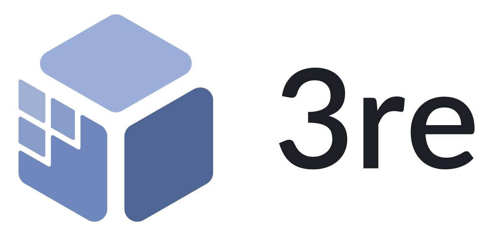
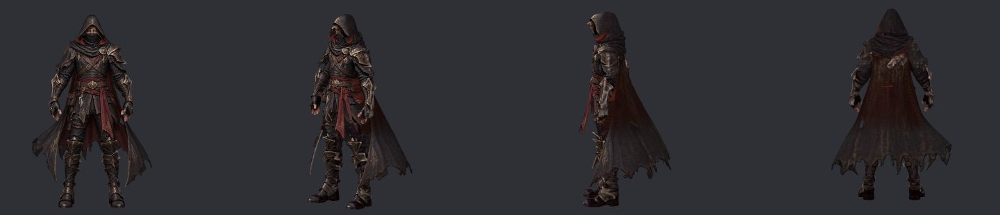
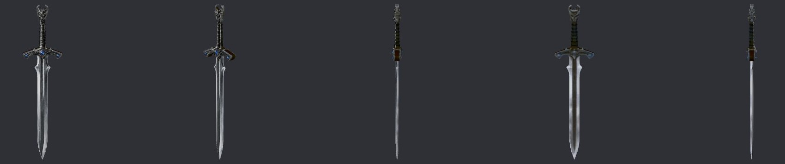
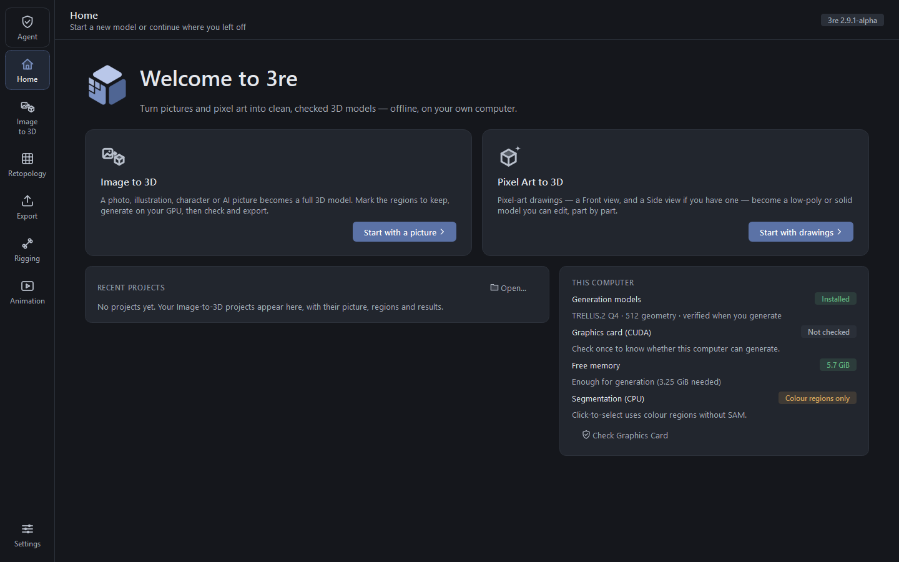
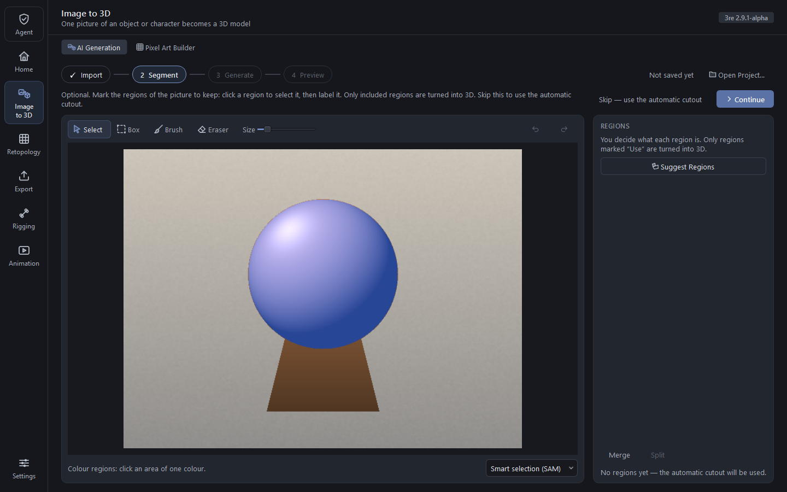

  <picture>
    <source media="(prefers-color-scheme: dark)" srcset="branding/png/3re-lockup-horizontal-dark.png">
    
  </picture>

<b>برنامج 3re يحوّل صورة واحدة إلى نموذج ثلاثي الأبعاد لألعابك. مجاني ومفتوح المصدر، ويعمل على حاسوبك أنت.</b>

<a href="README.md">English</a> · <b>العربية</b>

<!-- download:start -->

  

<!-- download:end -->

  
  

هذه نسخة مبكرة (ألفا). نسخة ويندوز غير موقّعة رقميًا بعد، لذلك قد يحذّرك ويندوز: <a href="#faq-unsigned">ماذا تفعل</a>.

<a href="#start">ابدأ</a> · <a href="#help"><b>ساعدني في بناء 3re</b></a> · <a href="#faq">أسئلة شائعة</a>

## ما هو 3re؟

يحوّل 3re صورة واحدة إلى نموذج ثلاثي الأبعاد بخامته، جاهز للألعاب. هو مجاني، ويعمل على حاسوبك أنت، ويحتاج إلى بطاقة
رسوميات (GPU) من NVIDIA بذاكرة 4 جيجابايت. لا تحتاج إلى حساب ولا إلى رصيد، وصورك لا تغادر حاسوبك أبدًا، وبعد تنزيل نماذج
الذكاء الاصطناعي مرة واحدة يعمل دون إنترنت.

## أمثلة

نماذج صنعها 3re من صورة واحدة، على بطاقة رسوميات لحاسوب محمول بذاكرة 4 جيجابايت.

| الصفحة الرئيسية | من صورة إلى 3D: حدّد الأجزاء التي تريد الاحتفاظ بها |
|---|---|
|  |  |

تستخدم لقطات الشاشة هذه صور الاختبار الاصطناعية الخاصة بـ 3re (`tests/fixtures`).

## ابدأ

1. **نزّل 3re لويندوز** من الزر في أعلى هذه الصفحة. يمكنك اختيار ملف zip المحمول (فكّه في أي مكان) أو المثبّت (يثبّت
   البرنامج لمستخدمك، دون صلاحيات مدير).
2. **شغّل `3re.exe`.** قد يحذّرك ويندوز في المرة الأولى: [ماذا تفعل](#faq-unsigned).
3. **نزّل نماذج الذكاء الاصطناعي.** يعرضها 3re مع حجم كل منها ومصدره ورخصته (نحو 5 جيجابايت إجمالًا). يمكنك تنزيلها الآن
   أو لاحقًا من الإعدادات.
4. **اصنع نموذجك.** أسقط صورة واضغط Generate. اقرأ النتيجة: PASS أو REVIEW أو FAIL، والسبب. ثم صدّر GLB أو glTF أو OBJ
   إلى Godot أو Unity أو Roblox أو أي أداة أخرى.

[دليل المستخدم](docs/USER-GUIDE.md) يشرح كل صفحة.

## ساعدني في بناء 3re

أبني 3re وحدي. هو مجاني ومفتوح المصدر، للجميع. يعمل، لكنه يحتاج إلى صقل، ويسعدني كثيرًا أن تساعدني. لا يلزم أن تكون خبيرًا،
وكل مساعدة صغيرة تفرق.

- **مطوّرو C++‎ وQt:** التطبيق نفسه، مثل [الواجهة](https://github.com/3reusa7/3re/issues?q=is%3Aissue%20is%3Aopen%20label%3Aui)
  و[التحديثات](https://github.com/3reusa7/3re/issues?q=is%3Aissue%20is%3Aopen%20label%3Aupdates).
- **المهتمون بالرسوميات ثلاثية الأبعاد:** صور اختبار أفضل وطرق أفضل لقياس الجودة:
  [مهام التقييم](https://github.com/3reusa7/3re/issues?q=is%3Aissue%20is%3Aopen%20label%3Aevaluation).
- **المهتمون بنماذج الذكاء الاصطناعي:** طريقة أفضل لاستخدام النماذج، تُختبَر بدراسة مكتوبة قصيرة:
  [اقترح تغييرًا](https://github.com/3reusa7/3re/issues/new?template=feature-request.yml).
- **المختبِرون ببطاقات رسوميات أخرى:** كل البطاقات غير مُختبَرة ما عدا RTX 3050 بذاكرة 4 جيجابايت:
  [أرسل تقرير عتاد](https://github.com/3reusa7/3re/issues/new?template=hardware-report.yml).
- **المترجمون:** اجعل 3re يتكلم لغتك:
  [مهام الترجمة](https://github.com/3reusa7/3re/issues?q=is%3Aissue%20is%3Aopen%20label%3Atranslation).
- **الوثائق والتصميم:** اجعل 3re أسهل فهمًا:
  [مهام الوثائق](https://github.com/3reusa7/3re/issues?q=is%3Aissue%20is%3Aopen%20label%3Adocumentation).

**مساهمتك الأولى في 3 خطوات:**

1. اختر [مهمة مناسبة للمبتدئين](https://github.com/3reusa7/3re/issues?q=is%3Aissue%20is%3Aopen%20label%3A%22good%20first%20issue%22)
   واكتب تعليقًا عليها، حتى لا يعمل شخصان على الشيء نفسه.
2. اقرأ [CONTRIBUTING.md](CONTRIBUTING.md)، ثم نفّذ تغييرك في فرع جديد.
3. افتح طلب سحب (pull request)، مع توقيع commits بالأمر `git commit -s`. هذا هو
   [Developer Certificate of Origin](https://developercertificate.org/).

يمكنك أيضًا الإبلاغ عن [خطأ](https://github.com/3reusa7/3re/issues/new?template=bug-report.yml). لبناء 3re من المصدر اقرأ
[docs/BUILDING.md](docs/BUILDING.md). ولفهم كيف تترابط أجزاؤه اقرأ [docs/ARCHITECTURE.md](docs/ARCHITECTURE.md). وللمشكلات
الأمنية اقرأ [SECURITY.md](SECURITY.md).

## ما الذي يعمل اليوم

ما زال 3re في مرحلة ألفا. هو بديل مجاني لخدمات تحويل الصور إلى 3D المدفوعة مثل Tripo 3D، لكنه لا يضاهيها في كل صورة بعد. لا
علاقة لـ 3re بشركة Tripo. كلمة "مُختبَر" تعني أنني اختبرته على حاسوبي: ويندوز 11، وبطاقة RTX 3050 لحاسوب محمول بذاكرة 4
جيجابايت، وذاكرة (RAM) بحجم 16 جيجابايت.

| الميزة | الحالة |
|---|---|
| من صورة واحدة إلى 3D باستخدام TRELLIS.2 (بطاقات NVIDIA مع CUDA فقط؛ نحو 7 دقائق للنموذج على البطاقة المُختبَرة) | ✅ يعمل |
| الخامة من صورتك، من زاوية واحدة أو عدة زوايا | ✅ يعمل |
| تحديد أجزاء الصورة بالنقر، باستخدام SAM 2.1 | ✅ يعمل |
| تصدير GLB أو glTF أو OBJ، مع إعدادات جاهزة لـ Godot وUnity وRoblox | ✅ يعمل |
| سطر الأوامر (`3re-cli`) وخادم MCP (`3re-mcp`) | ✅ يعمل |
| تحديثات موقّعة يمكنها الرجوع إلى النسخة السابقة (اختُبرت على خادم اختبار محلي؛ لم يستخدمها أي إصدار عام بعد) | 🧪 جديد |
| الوكيل (Asset Agent) والدردشة بالعربية والإنجليزية (دون إنترنت وقائم على قواعد؛ 6 من 11 نموذج اختبار نالت PASS) | 🧪 تجريبي |
| إعادة بناء الشبكة الذكية (Smart Retopology) باستخدام QuadWild (الأجزاء الرفيعة كالنصال قد تفشل) | 🧪 تجريبي |
| لينكس (NVIDIA CUDA)، وماك (Apple Silicon)، والتحريك | 🗺️ مخطط له |

[الحالة الكاملة وخارطة الطريق](docs/STATUS.md) فيها كل التفاصيل.

## العتاد المطلوب

| حاسوبك | ما يمكنك فعله |
|---|---|
| أي حاسوب بنظام ويندوز 10 أو 11 (64 بت) | تصدير نماذجك ثلاثية الأبعاد وإعادة بناء شبكتها |
| بطاقة NVIDIA بذاكرة 4 جيجابايت، وتعريف يدعم CUDA 12، و16 جيجابايت RAM، ونحو 6 جيجابايت مساحة فارغة | كل شيء، ومنه التحويل من صورة واحدة إلى 3D. هذا هو الإعداد المُختبَر. |
| بطاقات NVIDIA الأكبر | الشيء نفسه، وغالبًا أسرع. لم نقس ذلك بعد: [أرسل تقرير عتاد](https://github.com/3reusa7/3re/issues/new?template=hardware-report.yml). |
| بطاقات AMD أو Intel، أو دون بطاقة رسوميات | لا يعمل التحويل من صورة إلى 3D بعد، لأنه يحتاج إلى CUDA |

## أسئلة شائعة

**لماذا يحذّرني ويندوز من 3re؟** نسخ ويندوز غير موقّعة رقميًا بعد، لأن التوقيع يحتاج إلى شهادة مدفوعة. يحذّرك Windows
SmartScreen عند أول تشغيل لـ `3re.exe`. اختر "More info" ثم "Run anyway". وإن كان ويندوز بلغة أخرى فستظهر الأزرار بتلك اللغة.
وللتأكد مما نزّلته قارنه بملف `SHA256SUMS.txt` في صفحة الإصدار: `certutil -hashfile <file> SHA256`. وملف وصف التحديث موقّع
أيضًا ([كيف تعمل التحديثات](docs/UPDATES.md)).

**هل يرسل 3re صوري إلى أي مكان؟** لا. كل شيء يعمل على حاسوبك. الطلبات الوحيدة عبر الشبكة هي تنزيل النماذج التي توافق عليها،
وفحص يومي لقائمة إصدارات GitHub إن تركته مفعّلًا (Settings ← Updates). ولا يرسل هذا الفحص أي حساب أو معرّف أو بيانات استخدام.

**لماذا التنزيل صغير والنماذج كبيرة؟** نماذج الذكاء الاصطناعي كبيرة، فهي ليست داخل الحزمة. ينزّلها 3re عند أول استخدام بعد
موافقتك، ويتحقق من بصمة SHA-256 لكل ملف قبل استخدامه.

**هل يمكنني استخدام 3re تجاريًا؟** شيفرة 3re برخصة Apache-2.0. وللنماذج شروطها الخاصة: TRELLIS.2 برخصة MIT، ومُرمِّز الصور
DINOv3 داخله برخصة DINOv3 من Meta، وSAM 2.1 برخصة Apache-2.0 ([إشعارات الأطراف الثالثة](THIRD-PARTY-NOTICES.txt)). أنت مسؤول
عن امتلاك حقوق الصور التي تستخدمها. هذه ليست استشارة قانونية.

**هل يعمل دون بطاقة رسوميات من NVIDIA؟** ليس بعد. التحويل من صورة واحدة إلى 3D يحتاج إلى CUDA.

**ماذا تعني PASS وREVIEW وFAIL؟** هي نتائج فحوص مقيسة: هل النموذج مغلق؟ هل يتقاطع مع نفسه؟ هل يطابق صورتك؟ هل الملف سليم؟ راجع
[بوابات الجودة](docs/QUALITY.md). يبلّغ 3re عن العيوب التي لا يستطيع إصلاحها بدل إخفائها.

**كيف تعمل التحديثات؟** لا يثبّت 3re أي تحديث إلا بعد موافقتك. التحديث موقّع، ولكل ملف بصمة SHA-256، ويرجع 3re تلقائيًا إلى
النسخة السابقة إن فشلت النسخة الجديدة في فحصها الذاتي. وهناك قناتان: مستقرة وألفا. اقرأ [docs/UPDATES.md](docs/UPDATES.md).

## الرخصة

الرخصة هي Apache-2.0 ([LICENSE](LICENSE)، [NOTICE](NOTICE)). المكوّنات الخارجية والنماذج التي ينزّلها 3re مذكورة برخصها في
[THIRD-PARTY-NOTICES.txt](THIRD-PARTY-NOTICES.txt). Built with DINOv3.

