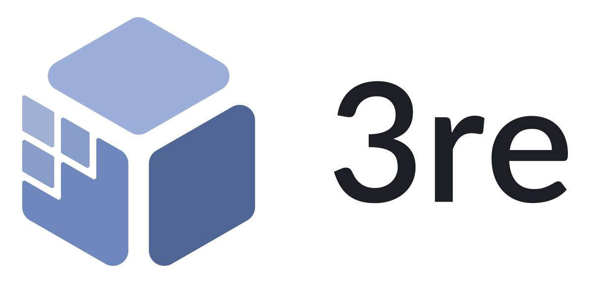
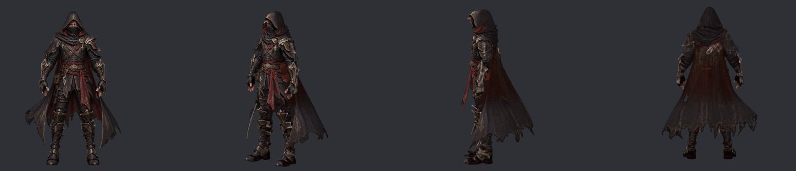
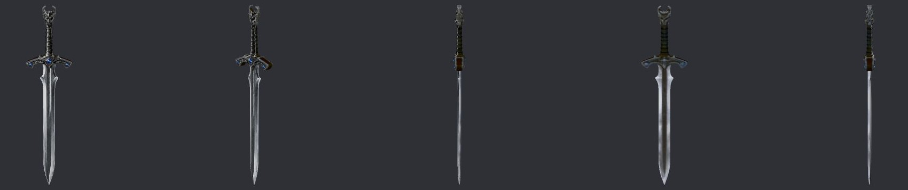

  <picture>
    <source media="(prefers-color-scheme: dark)" srcset="branding/png/3re-lockup-horizontal-dark.png">
    
  </picture>

<b>3re turns one picture into a 3D model for your games. It is free and open source, and it runs on your own PC.</b>

<b>English</b> · <a href="README.ar.md">العربية</a>

<!-- download:start -->

  

<!-- download:end -->

  
  

This is an early (alpha) version. The Windows build is not code-signed yet, so Windows may warn you: <a href="#faq-unsigned">what to do</a>.

<a href="#start">Get started</a> · <a href="#help"><b>Help me build 3re</b></a> · <a href="#faq">FAQ</a>

## What is 3re?

3re turns one picture into a textured 3D model for games. It is free, it runs on your own PC, and it needs an NVIDIA
graphics card (GPU) with 4 GB of memory. There is no account and there are no credits, your pictures never leave your
PC, and after a one-time download of the AI models it works offline.

## Examples

Models made by 3re from one picture, on a laptop graphics card with 4 GB of memory.

| Home | Image to 3D: mark the parts to keep |
|---|---|
|  |  |

These screenshots use 3re's own synthetic test pictures (`tests/fixtures`).

## Get started

1. **Download 3re for Windows** with the button at the top of this page. You can use the portable zip (unzip it
   anywhere) or the installer (it installs for your user, no admin rights needed).
2. **Start `3re.exe`.** Windows may warn you the first time: [what to do](#faq-unsigned).
3. **Download the AI models.** 3re lists them with their size, source and licence (about 5 GB in total). You can
   download them now or later from Settings.
4. **Make your model.** Drop a picture and press Generate. Read the result: PASS, REVIEW or FAIL, and why. Then export
   GLB, glTF or OBJ for Godot, Unity, Roblox or any other tool.

The [user guide](docs/USER-GUIDE.md) explains every page.

## Help me build 3re

I am building 3re on my own. It is free and open source, for everyone. It works, but it needs polishing, and I would
love your help. You do not need to be an expert, and small help counts.

- **C++ and Qt developers:** the app itself, for example the [interface](https://github.com/3reusa7/3re/issues?q=is%3Aissue%20is%3Aopen%20label%3Aui)
  and [updates](https://github.com/3reusa7/3re/issues?q=is%3Aissue%20is%3Aopen%20label%3Aupdates).
- **3D and graphics people:** better test pictures and ways to measure quality:
  [evaluation issues](https://github.com/3reusa7/3re/issues?q=is%3Aissue%20is%3Aopen%20label%3Aevaluation).
- **AI model people:** a better way to use the models, tested with a short written study:
  [propose a change](https://github.com/3reusa7/3re/issues/new?template=feature-request.yml).
- **Testers with other graphics cards:** every card except the RTX 3050 4 GB is untested:
  [send a hardware report](https://github.com/3reusa7/3re/issues/new?template=hardware-report.yml).
- **Translators:** make 3re speak your language:
  [translation issues](https://github.com/3reusa7/3re/issues?q=is%3Aissue%20is%3Aopen%20label%3Atranslation).
- **Docs and design:** make 3re easier to understand:
  [documentation issues](https://github.com/3reusa7/3re/issues?q=is%3Aissue%20is%3Aopen%20label%3Adocumentation).

**Your first contribution in 3 steps:**

1. Pick a [good first issue](https://github.com/3reusa7/3re/issues?q=is%3Aissue%20is%3Aopen%20label%3A%22good%20first%20issue%22)
   and comment on it, so that two people do not do the same work.
2. Read [CONTRIBUTING.md](CONTRIBUTING.md), then make your change on a new branch.
3. Open a pull request, with your commits signed off (`git commit -s`). This is the
   [Developer Certificate of Origin](https://developercertificate.org/).

You can also report a [bug](https://github.com/3reusa7/3re/issues/new?template=bug-report.yml). To build 3re from
source, read [docs/BUILDING.md](docs/BUILDING.md). To see how it fits together, read
[docs/ARCHITECTURE.md](docs/ARCHITECTURE.md). For security problems, read [SECURITY.md](SECURITY.md).

## What works today

3re is alpha. It is a free alternative to paid image-to-3D services such as Tripo 3D, but it does not match them on
every picture yet. 3re is not affiliated with Tripo. "Tested" means tested on my PC: Windows 11, a laptop RTX 3050
graphics card with 4 GB, and 16 GB of memory (RAM).

| Feature | Status |
|---|---|
| One picture to 3D with TRELLIS.2 (NVIDIA and CUDA only; about 7 minutes per model on the tested card) | ✅ Works |
| Texture from your picture, from one or several angles | ✅ Works |
| Click to select parts of the picture, with SAM 2.1 | ✅ Works |
| Export GLB, glTF or OBJ, with presets for Godot, Unity and Roblox | ✅ Works |
| Command line (`3re-cli`) and MCP server (`3re-mcp`) | ✅ Works |
| Signed updates that can go back to the previous version (tested on a local test server; no public release has used them yet) | 🧪 New |
| Asset Agent and chat, in Arabic and English (offline and rules-based; 6 of 11 test assets PASS) | 🧪 Experimental |
| Smart Retopology with QuadWild (thin parts such as blades can fail) | 🧪 Experimental |
| Linux (NVIDIA CUDA), macOS (Apple Silicon), animation | 🗺️ Planned |

The [full status and roadmap](docs/STATUS.md) has every detail.

## Hardware

| Your PC | What you can do |
|---|---|
| Any PC with Windows 10 or 11 (64-bit) | Export and retopology of your own 3D models |
| NVIDIA card with 4 GB of memory, CUDA 12 driver, 16 GB of RAM, about 6 GB of free disk | Everything, including one picture to 3D. This is the tested setup. |
| Bigger NVIDIA cards | The same, probably faster. Not measured yet: [send a hardware report](https://github.com/3reusa7/3re/issues/new?template=hardware-report.yml). |
| AMD or Intel cards, or no graphics card | No picture to 3D yet, because it needs CUDA |

## FAQ

**Why does Windows warn me about 3re?** The Windows builds are not code-signed yet, because signing needs a paid
certificate. Windows SmartScreen warns the first time you start `3re.exe`. Choose "More info", then "Run anyway". If
Windows is in another language, the buttons use that language. To be sure of what you downloaded, compare it with
`SHA256SUMS.txt` in the release: `certutil -hashfile <file> SHA256`. The update manifest is signed too
([how updates work](docs/UPDATES.md)).

**Does 3re send my pictures anywhere?** No. Everything runs on your PC. The only network requests are the model
downloads you agree to and, if you leave it on, a daily check of the GitHub releases list (Settings → Updates). That
check sends no account, identifier or usage data.

**Why is the download small but the models big?** The AI models are large, so they are not in the package. 3re
downloads them on first use, after you agree, and checks the SHA-256 of every file before using it.

**Can I use 3re commercially?** 3re's code is Apache-2.0. The models have their own terms: TRELLIS.2 is MIT, its DINOv3
image encoder is under Meta's DINOv3 License, and SAM 2.1 is Apache-2.0
([third-party notices](THIRD-PARTY-NOTICES.txt)). You are responsible for having the rights to the pictures you use.
This is not legal advice.

**Does it work without an NVIDIA graphics card?** Not yet. One picture to 3D needs CUDA.

**What do PASS, REVIEW and FAIL mean?** They are the results of measured checks: is the model closed, does it cut into
itself, does it match your picture, is the file valid? See [quality gates](docs/QUALITY.md). 3re reports defects it
cannot repair instead of hiding them.

**How do updates work?** 3re installs an update only after you confirm. The update is signed, every file has a SHA-256,
and 3re goes back to the previous version by itself if the new one fails its self-test. There are stable and alpha
channels. Read [docs/UPDATES.md](docs/UPDATES.md).

## Licence

Apache-2.0 ([LICENSE](LICENSE), [NOTICE](NOTICE)). Third-party components and the models 3re downloads are listed with
their licences in [THIRD-PARTY-NOTICES.txt](THIRD-PARTY-NOTICES.txt). Built with DINOv3.
