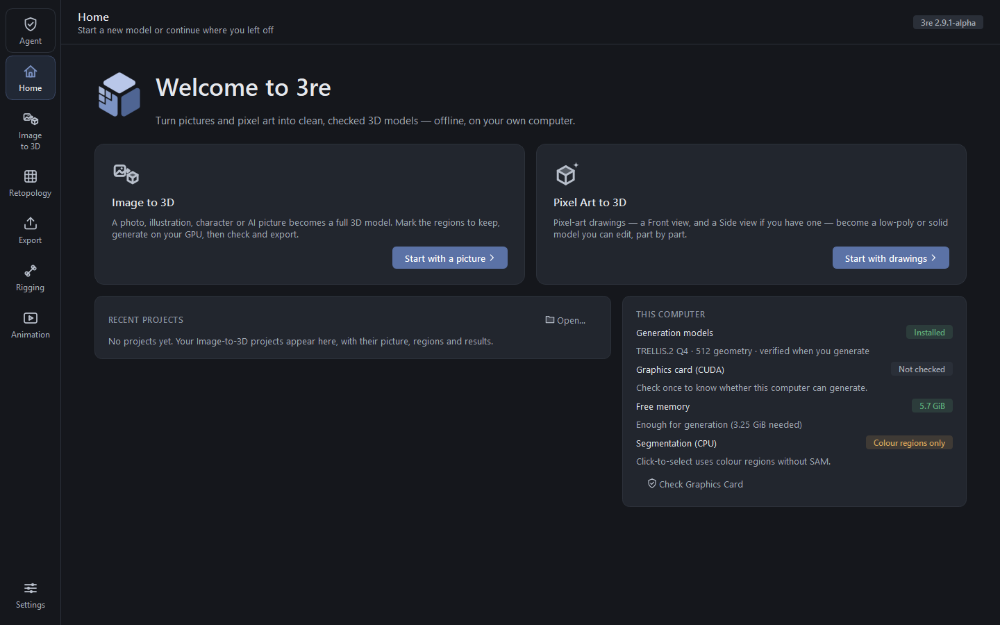
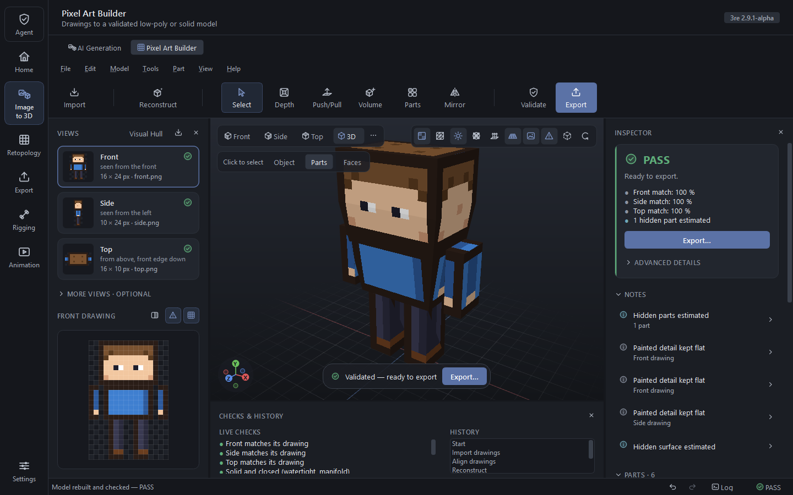
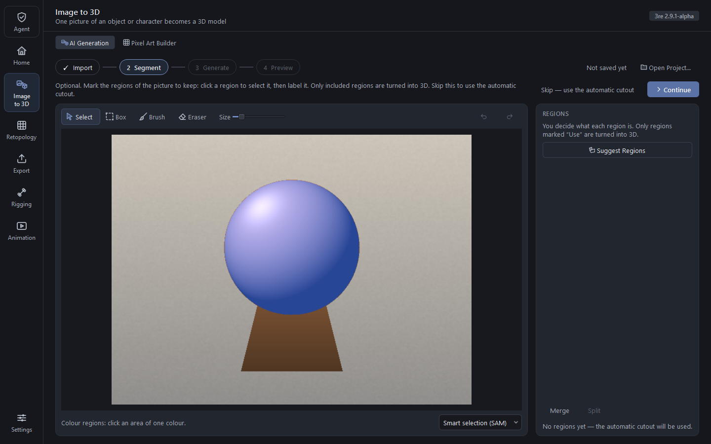
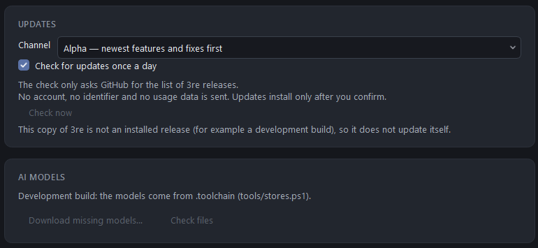

  

<b>Pictures and pixel art to clean, checked 3D game assets — offline, on your own Windows PC.</b>

  
  
   
  
  
  
  

> **The Windows builds are not code-signed yet.** Windows SmartScreen will warn the first time you start
> `3re.exe` ("More info" → "Run anyway"). Every release lists the SHA-256 of each file, and the update manifest
> is signed (see [Updates](docs/UPDATES.md)), so you can check what you downloaded.

3re turns **one picture** into a textured 3D model with TRELLIS.2 on an NVIDIA graphics card, or **pixel-art
drawings** (a front view, plus side and top if you have them) into a solid, editable low-poly model. Every result is
checked before you export it — watertight or not, matches the drawing or not, glTF valid or not — and 3re says
PASS, REVIEW or FAIL instead of guessing.

| Home | Pixel Art Builder |
|---|---|
|  |  |
| **Image to 3D: mark the regions to keep** | **Updates: signed, and only after you confirm** |
|  |  |

Screenshots use 3re's own synthetic test pictures (`tests/fixtures`).

## What works today

Honest status of 3re 2.9 (alpha). "Tested" means on the maintainer's PC: Windows 11, RTX 3050 laptop GPU with
4 GB, 16 GB RAM.

| Feature | Status | Notes |
|---|---|---|
| Pixel Art Builder: front/side/top drawings → solid model, edit, export | ✅ Works | Watertight check, drawing match per view, part editing, undo |
| Low-Poly Studio (stylised characters from a front and side drawing) | ✅ Works | Limb chains, profiles; rigging is experimental (below) |
| Image to 3D with TRELLIS.2 (Q4, 512) | ✅ Works, tested on 4 GB | About 7 minutes per model on the tested GPU; NVIDIA + CUDA only |
| Texture from your picture (hybrid / auto texture, several angles) | ✅ Works | Hidden sides use TRELLIS's own texture; a hidden-side gate reports doubtful backs |
| Regions with SAM 2.1 tiny (click to select) | ✅ Works | Runs on the CPU |
| Export GLB / glTF / OBJ, presets for Godot, Unity, Roblox | ✅ Works | Checked by the Khronos glTF-Validator |
| Command line (`3re-cli`) and MCP server (`3re-mcp`) | ✅ Works | Same engine as the app |
| Updates from GitHub Releases, signed, with roll-back | 🧪 New | Tested end to end against a local test server; no public release has used it yet |
| Game-Ready Asset Agent and chat (Arabic and English) | 🧪 Experimental | Rules-based, offline; on our regression set 6 of 11 assets PASS (2.7.0) — [details](docs/agent/README.md) |
| Smart Retopology (QuadWild) | 🧪 Experimental | Thin parts (blades) can fail; results are measured, never assumed |
| Rigging | 🧪 Experimental | Low-Poly Studio models only |
| Linux (NVIDIA CUDA) | 🗺️ Planned | Platform layer first, then CI builds |
| macOS (Apple Silicon) | 🗺️ Planned | After Linux |
| Animation | 🗺️ Planned | Shown as "Coming soon" in the app |

## Hardware

| Tier | What you can do | Needs |
|---|---|---|
| Any PC | Pixel Art Builder, Low-Poly Studio, export, retopology of your own meshes | Windows 10/11 64-bit, OpenGL 3.3 (or the software 3D view) |
| **Tested for AI** | Image to 3D, textures, regions, Agent | NVIDIA GPU with **4 GB** VRAM and a CUDA 12 driver, **16 GB RAM**, about 6 GB free disk for the models |
| Bigger NVIDIA GPUs | The same, probably faster | Not measured by us yet — [send a hardware report](../../issues/new?template=hardware-report.yml) |
| AMD / Intel GPUs, CPU only | Pixel art features only | Image to 3D needs CUDA |

## Quick start

1. **Download** the portable zip (unzip anywhere) or the installer (installs for your user, no admin rights) from
   [Releases](../../releases/latest).
2. **Start `3re.exe`.** Windows may warn because the build is not signed: "More info" → "Run anyway".
3. **Choose the AI models.** On the first start 3re lists what it can download (about 5 GB: GPU engine libraries,
   TRELLIS.2 weights, SAM 2.1), with each size, source and licence. Download now, later from Settings, or never —
   Pixel Art Builder works without them.
4. **Make a model.** *Image to 3D*: drop a picture, optionally mark the regions to keep, press Generate.
   *Pixel Art Builder*: drop your front (and side/top) drawing. Read the checks: PASS, REVIEW or FAIL, and why.
5. **Export** GLB, glTF or OBJ with the preset for your engine (Godot, Unity, Roblox or generic).

The [user guide](docs/USER-GUIDE.md) goes through every page.

## FAQ

**Does 3re send my pictures anywhere?** No. Everything runs on your PC. The only network requests are the model
downloads you agree to and, if you leave it on, a daily check of the GitHub releases list (Settings → Updates); it
sends no account, identifier or usage data.

**Why is the download small but the models big?** The AI weights are not ours to bundle and are large; 3re downloads
them from their original sources on first use and checks every file's SHA-256 before using it.

**Can I use 3re commercially?** 3re's code is Apache-2.0. The models have their own terms: TRELLIS.2 is MIT, its
DINOv3 image encoder is under Meta's DINOv3 License, SAM 2.1 is Apache-2.0
([third-party notices](THIRD-PARTY-NOTICES.txt)). You are responsible for having the rights to the pictures you put
in. This is not legal advice.

**Does it work without an NVIDIA GPU?** The pixel-art features do. Image to 3D needs CUDA.

**What do PASS / REVIEW / FAIL mean?** They are the result of measured checks (watertightness, self-intersection,
match with your drawing or picture, glTF validity) — see [quality gates](docs/QUALITY.md). 3re reports defects it
cannot repair instead of hiding them.

**How do updates work?** See [docs/UPDATES.md](docs/UPDATES.md): signed manifest, SHA-256 per file, install only after
you confirm, automatic roll-back if the new version fails its self-test, stable and alpha channels.

## Roadmap

- **Now:** the 2.10 and 2.11 releases (asset quality: transform hygiene, region refinement, part separation).
- **Next:** a platform layer and the Linux (CUDA) build; CI-built GPU engine; a decision on code signing.
- **Later:** macOS on Apple Silicon (experimental), animation.

The live plan is the project board; ideas and questions go to Discussions.

## Help 3re

- Try it on your hardware and [send a hardware report](../../issues/new?template=hardware-report.yml) — other GPUs are
  the biggest unknown.
- Pick a [good first issue](docs/good-first-issues.md), or report a [bug](../../issues/new?template=bug-report.yml).
- Improve the docs or the Arabic translation.
- Read [CONTRIBUTING.md](CONTRIBUTING.md) first: contributions are signed off under the
  [Developer Certificate of Origin](https://developercertificate.org/).

Build from source: [docs/BUILDING.md](docs/BUILDING.md). How it fits together: [docs/ARCHITECTURE.md](docs/ARCHITECTURE.md).
Security issues: [SECURITY.md](SECURITY.md).

## Licence

Apache-2.0 ([LICENSE](LICENSE), [NOTICE](NOTICE)). Third-party components and the models 3re downloads are listed
with their licences in [THIRD-PARTY-NOTICES.txt](THIRD-PARTY-NOTICES.txt). Built with DINOv3.
