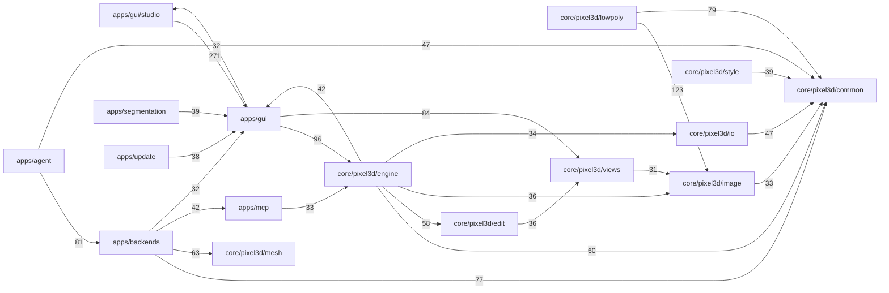

# 3re architecture

3re is one C++20 code base built with CMake (MinGW 13.1, Qt 6.8.3 on Windows). A Qt-free engine library holds
all modelling logic; every front end (desktop app, command line, MCP server, agent) calls the same engine.
The AI generation runs as separate processes (the TRELLIS.2 engine `trellis-cli.exe`, QuadWild), so a crash or
an out-of-memory there never takes the app down.

## Layers

| Layer | Folders | CMake targets | Depends on |
|---|---|---|---|
| Engine (no Qt) | `core/pixel3d/*` | `pixel3d-core` | vendored libraries (`third_party/`) |
| Back ends | `apps/backends`, `apps/segmentation`, `apps/agent`, `apps/update` | `p3d_trellis_backend`, `p3d_segmentation`, `p3d_agent_core`, `p3d_agent_chat`, `p3d_update_core`, `p3d_update`, … | engine; Qt Core/Gui/Network for the Qt parts |
| Front ends | `apps/gui` (3re-studio), `apps/cli`, `apps/mcp`, `apps/launcher` | `Pixel3D` (3re-studio.exe), `pixel3d-cli` (3re-cli.exe), `Pixel3D-mcp` (3re-mcp.exe), `threere-launcher` (3re.exe) | back ends, engine |
| Helper programs | `apps/backends/*_cli.cpp`, `tools/trellis`, `tools/glbcheck` | `pixel3d-auto-texture`, `pixel3d-retopo`, `pixel3d-trellis-post-safe`, `3re-update`, … | engine |
| Separate engines (prebuilt) | — | `trellis-cli.exe` (trellis.cpp fork), QuadWild | run as processes, files in and out |

What happens when you press **Generate** (Image to 3D): the picture is normalised (`apps/backends/image_input`),
regions become the cutout (`apps/segmentation`), `TrellisBackend` checks free memory and starts `trellis-cli.exe`
with the downloaded weights, `pixel3d-trellis-post-safe.exe` cleans the mesh without creating self-intersections,
the texture worker (`pixel3d-auto-texture.exe`) paints it from the picture, and the result is validated
(`core/pixel3d/validate`, Khronos glTF-Validator) before the workspace shows PASS, REVIEW or FAIL.

**Pixel Art Builder**: the drawings (`core/pixel3d/image`, `views`) are segmented and matched across views
(`segment`, `correspond`), reconstructed as solids with Manifold booleans (`reconstruct`, `polygon`) or as a low-poly
character (`lowpoly`), edited as replayable operations (`edit`, `engine`), then rendered back and compared with every
drawing (`render`, `validate`).

**Updates and first-run downloads**: see [UPDATES.md](UPDATES.md).

## Module map (graphify)

Made with the code extraction of graphify (tree-sitter, no language model)
over `apps/`, `core/` and `tools/trellis`, aggregated per folder by `tools/docs/module_map.py`:

```
graphify update <copy of apps, core, tools/trellis>
python -I tools/docs/module_map.py <copy>/graphify-out/graph.json
```

Calls are resolved by name, so a few edges between folders that share common names (for example `path()` or
`tr()`) are approximate; the CMake targets above are the authoritative link dependencies. Numbers are relations
between symbols.

Graph: 8885 symbols, 21339 relations; 30 modules.

| Module | Files | Symbols | Depends most on |
|---|---|---|---|
| `apps/agent` | 36 | 797 | `apps/backends` (81), `core/pixel3d/common` (47), `apps/gui` (22) |
| `apps/backends` | 40 | 718 | `core/pixel3d/common` (77), `core/pixel3d/mesh` (63), `apps/mcp` (42) |
| `apps/cli` | 3 | 42 | `core/pixel3d/common` (15), `core/pixel3d/engine` (10), `core/pixel3d/io` (4) |
| `apps/gui` | 42 | 1447 | `core/pixel3d/engine` (96), `core/pixel3d/views` (84), `apps/gui/studio` (32) |
| `apps/gui/project` | 2 | 34 | `apps/gui` (4), `apps/backends` (1) |
| `apps/gui/shell` | 10 | 57 | `apps/gui` (22), `core/pixel3d/image` (1), `apps/gui/studio` (1) |
| `apps/gui/studio` | 33 | 760 | `apps/gui` (271), `apps/backends` (21), `core/pixel3d/common` (17) |
| `apps/launcher` | 1 | 6 | — |
| `apps/mcp` | 13 | 213 | `core/pixel3d/engine` (33), `apps/gui` (17), `core/pixel3d/common` (11) |
| `apps/segmentation` | 10 | 222 | `apps/gui` (39), `apps/backends` (2), `core/pixel3d/image` (1) |
| `apps/update` | 16 | 257 | `apps/gui` (38), `apps/backends` (15), `tools/trellis` (6) |
| `core/pixel3d/analysis` | 4 | 22 | `core/pixel3d/views` (10), `core/pixel3d/reconstruct` (3), `core/pixel3d/correspond` (3) |
| `core/pixel3d/common` | 14 | 70 | `apps/backends` (10), `tools/trellis` (5), `apps/mcp` (2) |
| `core/pixel3d/correspond` | 6 | 122 | `core/pixel3d/segment` (28), `core/pixel3d/views` (11), `core/pixel3d/reconstruct` (9) |
| `core/pixel3d/edit` | 10 | 175 | `core/pixel3d/views` (36), `core/pixel3d/reconstruct` (30), `core/pixel3d/common` (24) |
| `core/pixel3d/engine` | 25 | 578 | `core/pixel3d/common` (60), `core/pixel3d/edit` (58), `apps/gui` (42) |
| `core/pixel3d/image` | 12 | 274 | `core/pixel3d/common` (33), `tools/trellis` (20), `apps/gui` (6) |
| `core/pixel3d/io` | 17 | 172 | `core/pixel3d/common` (47), `core/pixel3d/image` (19), `core/pixel3d/render` (17) |
| `core/pixel3d/lowpoly` | 34 | 577 | `core/pixel3d/image` (123), `core/pixel3d/common` (79), `core/pixel3d/views` (17) |
| `core/pixel3d/mesh` | 5 | 46 | `core/pixel3d/common` (17), `apps/mcp` (4) |
| `core/pixel3d/polygon` | 6 | 51 | `core/pixel3d/common` (10), `core/pixel3d/image` (8), `apps/gui` (2) |
| `core/pixel3d/reconstruct` | 12 | 59 | `core/pixel3d/views` (26), `core/pixel3d/polygon` (15), `core/pixel3d/mesh` (14) |
| `core/pixel3d/render` | 6 | 87 | `core/pixel3d/common` (26), `core/pixel3d/image` (12), `core/pixel3d/views` (7) |
| `core/pixel3d/segment` | 4 | 53 | `core/pixel3d/image` (8), `core/pixel3d/views` (4), `apps/gui` (2) |
| `core/pixel3d/style` | 16 | 188 | `core/pixel3d/common` (39), `core/pixel3d/polygon` (23), `core/pixel3d/image` (22) |
| `core/pixel3d/texture` | 10 | 69 | `core/pixel3d/common` (14), `core/pixel3d/views` (12), `core/pixel3d/render` (9) |
| `core/pixel3d/validate` | 6 | 74 | `core/pixel3d/image` (9), `core/pixel3d/render` (8), `core/pixel3d/analysis` (6) |
| `core/pixel3d/views` | 5 | 90 | `core/pixel3d/image` (31), `core/pixel3d/common` (10), `apps/gui` (2) |
| `tools/glbcheck` | 1 | 4 | `apps/mcp` (1) |
| `tools/trellis` | 9 | 181 | `apps/mcp` (24), `core/pixel3d/mesh` (3), `core/pixel3d/common` (2) |

Strongest relations between modules:



## Where to start reading

- `apps/gui/main.cpp` — every command-line option of the app, the start sequence.
- `core/pixel3d/engine/session.hpp` — the engine's command surface shared by the app, the CLI and the MCP server.
- `apps/backends/trellis_backend.cpp` — how a generation runs (memory admission, processes, checks).
- `apps/agent/` and [docs/agent/README.md](agent/README.md) — the Game-Ready Asset Agent.
- `apps/update/` — signed updates, the folder swap and the first-run model store.
- `tests/` — one test executable per area; `ctest` runs them all.
